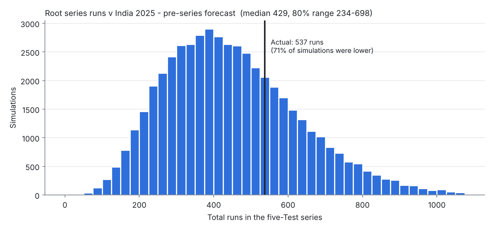

# Joe Root – pricing a Test innings

**Question:** before Joe Root walks out to bat, what's the chance he makes 10, 50, 100 – and what are fair odds on any runs line?

A single "expected runs" number can't be bet on. This model produces Root's **full score distribution** for an innings, tests it **out-of-sample**, and converts it into **fair prices** that can be compared with bookmaker odds.


## Headline results

| | |
|---|---|
| Data | All 309 of Root's Test innings, Dec 2012 – Sep 2026 (ESPNcricinfo Statsguru), 14,278 runs, 26 not-outs |
| Next home innings (as at 17 Nov 2026) | Mean 51 runs, median 29 · P(50+) 37% · P(100+) 15% → fair odds 50+ **2.72**, 100+ **6.50** |
| India 2025, forecast before the series | Median 429 runs (80% range 234–698), 1.3 hundreds expected |
| India 2025, what happened | **537 runs**, 3 hundreds – 71st percentile of the forecast: a good series, well inside the range |



## What I found

1. **Root's scoring is remarkably stable.** I tuned how much weight to give recent form, home vs away, and 1st/2nd vs 3rd/4th match innings on 2016–22, then tested on 2023–26. The best out-of-sample setting gave almost **equal weight to everything**: none of those factors improved predictions. For a batter this consistent, recent form is mostly noise. *Hypothesis to test against market prices: if bookmakers move his lines a lot on recent scores, that's where the value is.*
2. **Not-outs matter most in the tail.** Counting a 180\* as a dismissal at 180 understates his big-score chances. On the 2023–26 hold-out he made 100+ in 18.1% of innings; the naive count said 12.8%, the model 14.6%, and the model's log loss was 1.4% better. At 10/30/50 the two are level – that part of his distribution is well pinned down by 300 innings either way.
3. **More model ≠ better model.** The first version (in `legacy/`) used a random forest on 25 innings and forecast **865 runs** for the series – a single number with no uncertainty, 60% above what happened. A ~40-line survival model with honest uncertainty did much better.

Out-of-sample, 2023–2026 (walk-forward: every prediction uses only innings that had already happened):

| Threshold | Innings | Actual hit rate | Model avg prob | Naive avg prob | Log-loss change vs naive |
|---|---|---|---|---|---|
| 10+ | 76 | 78.9% | 76.0% | 75.2% | −0.2% (better) |
| 30+ | 75 | 48.0% | 49.7% | 48.3% | +0.1% |
| 50+ | 75 | 36.0% | 37.5% | 36.2% | +0.1% |
| 100+ | 72 | 18.1% | 14.6% | 12.8% | **−1.4% (better)** |

*Naive = share of his past scores at or above the threshold, counting not-outs as dismissals. A not-out below the threshold is left out of that row's scoring, since we never learn whether he'd have got there.*

## Method

- **Batting as survival.** At each run Root either gets out (the *hazard*) or carries on. The hazard is held constant within bands (0, 1–4, 5–9, 10–19 … 150–199, 200+) and estimated from past innings.
- **Not-outs are censored.** A not-out tells us he survived to that score, not where he'd have been dismissed – so it adds exposure but no dismissal.
- **Weights.** Optional decay for older innings, and down-weighting for innings in different conditions (home/away, match innings). Tuned by walk-forward log loss.
- **Shrinkage.** Each band's hazard is pulled towards his whole-career value, so a band with little data can't produce extreme numbers.
- **Series.** Monte Carlo of five Tests: one first-half innings each, plus a second innings with the probability he's batted twice in past home Tests (75%).
- **Prices.** Fair decimal odds = 1 / probability. A bet only has value if the bookmaker's odds beat the fair odds: *edge = odds × prob − 1*.

## Run it

```bash
pip install -r requirements.txt
python root_model.py all --home --first-innings   # backtest + India 2025 + price next innings
python root_model.py price --asof 2026-11-17      # away / 3rd-4th innings prices
python fetch_data.py                              # refresh data from Statsguru
```

Outputs go to `output/` (`run_log.txt` has the full printout).

## Changes from the first version

The original script (`legacy/Joe Root Analysis.py`) no longer ran and had modelling problems:

- The Statsguru URL format now returns *Page Not Found*; venue names didn't match Statsguru's (*Trent Bridge/Headingley/Edgbaston* vs *Nottingham/Leeds/Birmingham*), so the forecast step would crash. The 2025 venues also included Trent Bridge instead of **Old Trafford**.
- Not-outs were stripped of `*` and treated as dismissals.
- A random 80/20 split let the model train on innings that came after the ones it was tested on.
- At forecast time the form feature was fixed at its average, so form never influenced the forecast.
- Statsguru's "Inns" is the **match** innings (1–4), but the forecast used 1 and 2 as if they meant Root's first and second innings.
- 200 trees on 25 data points; a win model on a few dozen matches judged by accuracy.

Data is now saved in `data/`, so results reproduce without scraping.

## Next steps

- **Bookmaker odds.** Record pre-match odds for Root's runs and 50+/100+ markets for a series and measure model edge and closing-line value. That's the real test.
- **Ball-by-ball data** (Cricsheet) for bowling-attack and pitch effects, and in-play pricing as an innings develops.
- **Opposition and conditions** as proper covariates (e.g. a hazard model with home, opposition strength and batting position) once there's evidence they add value out-of-sample.
- Extend to the rest of England's top order and price *top England batter*.
