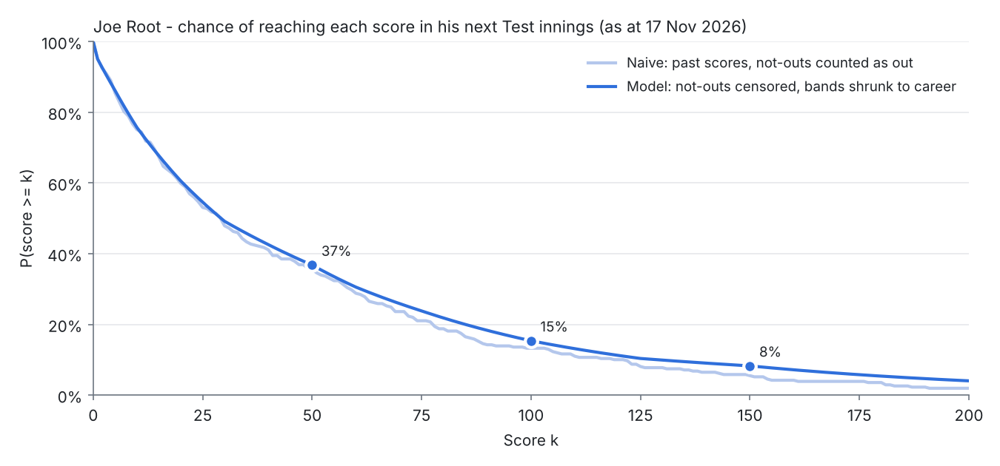

# England v India 2025 - predicting Joe Root and the series

A project to predict the 2025 India v England Test series. It set out to answer three questions before the first ball:

1. **How many runs will Joe Root score per Test, and what will his average be?**
2. **How many will he score across the series, and how many hundreds?**
3. **Can we predict the series result?**

The forecast uses only data from before the series started (20 June 2025), so it can be checked fairly against what actually happened.


## Results: forecast v what happened

### 1. Root's runs per Test and average

| | Forecast before the series | Actual |
|---|---|---|
| Runs per innings | 51.6 on average (median 30) | 59.7 |
| Runs per Test | 90 on average (80% range 11-210) | 81, 28, 144, 150, 134 |
| Series batting average | 54.0 (80% range 30-88) | **67.1** |

| Test | Ground | Root's runs |
|---|---|---|
| 1st | Headingley | 28 & 53* = 81 |
| 2nd | Edgbaston | 22 & 6 = 28 |
| 3rd | Lord's | 104 & 40 = 144 |
| 4th | Old Trafford | 150 = 150 |
| 5th | The Oval | 29 & 105 = 134 |

### 2. Series runs and hundreds

| | Forecast | Actual |
|---|---|---|
| Series total | Median 431 runs (80% range 232-696) | **537** |
| Where the actual sat | | 71st percentile - a good series, well inside the range |
| Hundreds | 1.3 expected | 3 |

### 3. Series result

To link Root to the result, I looked at every England home Test he played before the series (79 matches) and how England got on depending on his runs in the match:

| Root's runs in the match | England won | Drawn | England lost | Matches |
|---|---|---|---|---|
| Under 50 | 48% | 19% | 34% | 26 |
| 50-99 | 59% | 11% | 29% | 27 |
| 100+ | 75% | 12% | 13% | 26 |

Feeding Root's simulated runs for each Test through this table gave:

| | Forecast | Actual |
|---|---|---|
| Series winner | England 76%, drawn 11%, India 13% | **Drawn 2-2** |
| Most likely scorelines | 4-1 (17%), 3-1 (16%), 3-2 (14%), 2-2 (10%) | 2-2 |

**The series result is where the model fell short.** Root scored more than forecast, yet England only drew. The table above is based on England's home record against every opponent, and Root's runs are only one part of a Test result. India's batting and bowling, which this model doesn't look at, decided this series. Predicting results properly would need team-level data for both sides.

## What I found

1. **Root's scoring is remarkably stable.** I tuned how much weight to give recent form, home v away, and 1st/2nd v 3rd/4th match innings on 2016-22, then tested on 2023-26. The best setting gave almost equal weight to everything: none of those factors improved predictions. For a batter this consistent, recent form is mostly noise.
2. **Not-outs matter most for big scores.** Counting a 180* as a dismissal at 180 understates his chances of big scores. On 2023-26 he made 100+ in 18.1% of innings; simply counting past scores said 12.8%, the model said 14.6%. For 10, 30 and 50 the two are level.
3. **A bigger model isn't a better model.** The first version (in `legacy/`) used a random forest on 25 innings and forecast 865 runs for the series - a single number with no range, 60% above what happened. The simpler model with an honest range did much better.

## Checking the model on innings it hadn't seen

Tuned on 2016-2022, then tested on every innings from 2023 to 2026. Each prediction uses only innings that had already happened.

| Score | Innings | Actual rate | Model | Simple count of past scores | Model v simple count |
|---|---|---|---|---|---|
| 10+ | 76 | 78.9% | 76.0% | 75.2% | slightly better |
| 30+ | 75 | 48.0% | 49.7% | 48.3% | level |
| 50+ | 75 | 36.0% | 37.5% | 36.2% | level |
| 100+ | 72 | 18.1% | 14.6% | 12.8% | **better (1.4%)** |

The simple count treats not-outs as dismissals. A not-out below the score is left out of that row, since we never learn whether he'd have got there. "Better" is measured by log loss.

## Root's next innings (as at 17 Nov 2026)

The same model, updated with all 309 of his Test innings to September 2026, for a home Test innings:



| Score | Chance he reaches it |
|---|---|
| 50+ | 37% |
| 100+ | 15% |
| 150+ | 8% |

Expected runs 51, median 29.

## How it works

- **Data.** All of Root's Test innings from ESPNcricinfo Statsguru (309 innings, 14,278 runs, 26 not-outs) and England's home Test results, saved in `data/`.
- **Batting as survival.** At each run Root either gets out or carries on. The chance of getting out is held constant within bands of runs (0, 1-4, 5-9, 10-19 ... 150-199, 200+) and estimated from his past innings.
- **Not-outs.** A not-out tells us he survived to that score, not where he'd have been dismissed, so it counts as runs survived but not as a dismissal.
- **Weights.** Older innings and innings in different conditions (home/away, match innings) can be given less weight. The weights were tuned on past seasons.
- **Shrinkage.** Each band is pulled towards his whole-career figure, so a band with little data can't produce extreme numbers.
- **Series.** Simulated 50,000 times: five Tests, one first innings each, a second innings in 75% of Tests (how often he batted twice in past home Tests), and not-outs at his career rate for the average.
- **Result.** Each simulated Test's Root runs give England's chance of a win, draw or loss from the table above; adding up five Tests gives the series result.

## Run it

```bash
pip install -r requirements.txt
python root_model.py all --home --first-innings   # backtest, India 2025 forecast, next-innings chances
python root_model.py series                       # India 2025 forecast only
python root_model.py predict --asof 2026-11-17    # away / 3rd-4th innings chances
python fetch_data.py                              # refresh Root's innings from Statsguru
```

Outputs go to `output/` (`run_log.txt` has the full printout).

## Changes from the first version

The original script (`legacy/Joe Root Analysis.py`) no longer ran and had some modelling problems:

- The Statsguru link now returns "Page Not Found", and the ground names didn't match Statsguru's ("Trent Bridge", "Headingley", "Edgbaston" v "Nottingham", "Leeds", "Birmingham"), so the forecast step would crash. The 2025 grounds also had Trent Bridge instead of Old Trafford.
- Not-outs were counted as dismissals.
- A random 80/20 split let the model learn from innings that came after the ones it was tested on.
- At forecast time the form figure was fixed at its average, so form never affected the forecast.
- Statsguru's "Inns" column is the match innings (1-4), but the forecast used 1 and 2 as if they were Root's first and second innings.
- 200 trees on 25 innings, and a win model on a few dozen matches judged only by accuracy.
